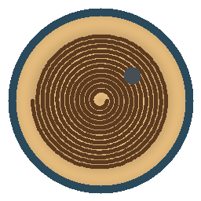
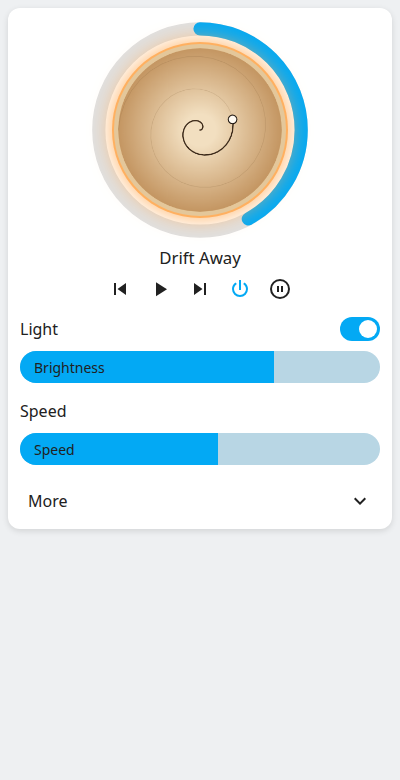
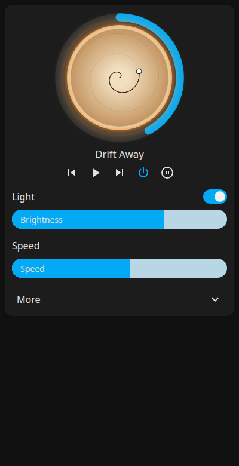
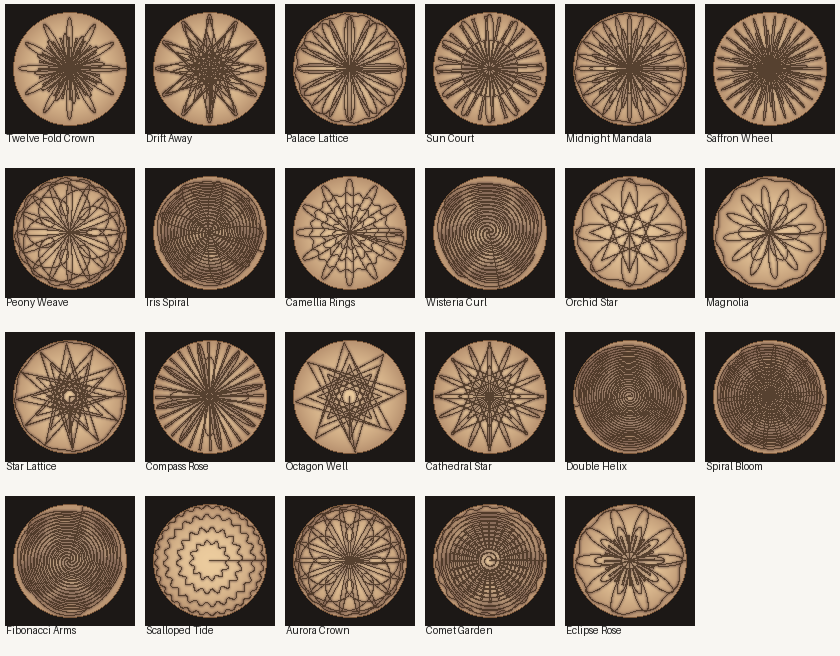
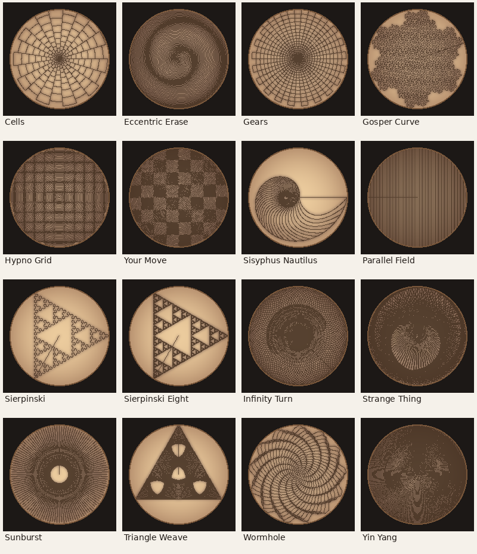
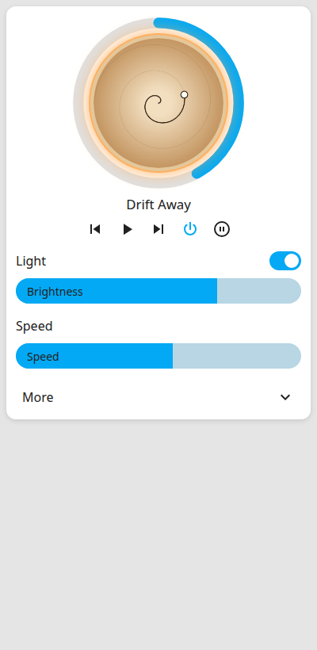
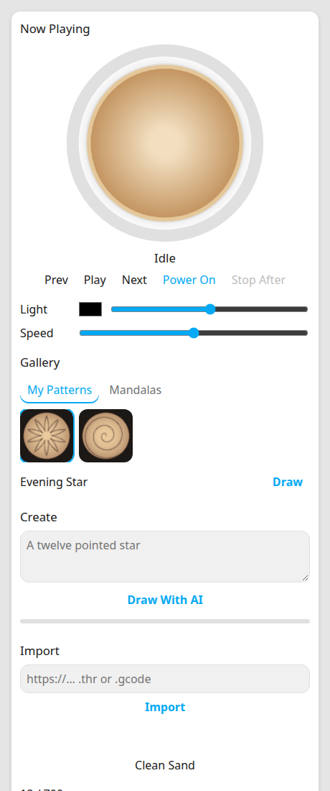
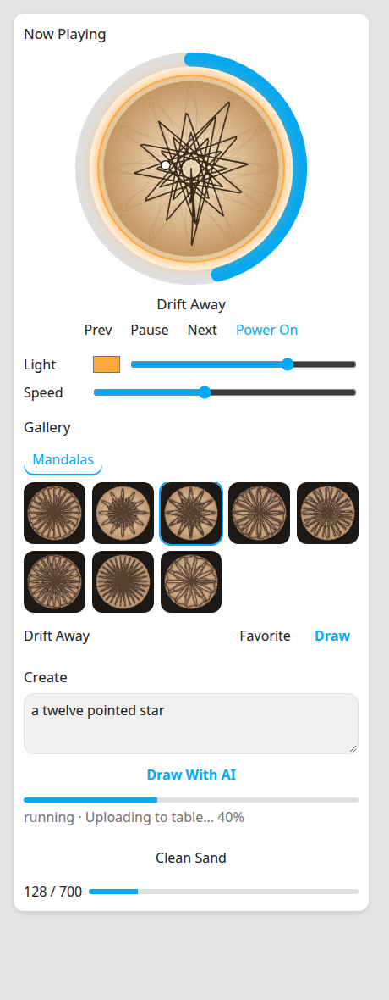

# HoMedics Drift



Home Assistant custom integration for the Bluetooth HoMedics Drift sand tables. It talks to the table through Home Assistant's Bluetooth integration, so a USB adapter or an ESPHome Bluetooth proxy both work. No table address is hardcoded.

**This project is unofficial and is not affiliated with, endorsed by, or supported by HoMedics.** It drives a motorized sand table over an undocumented Bluetooth protocol. Use it at your own risk. A bad or interrupted session can leave a drawing unfinished; it should not damage the table, but that is not a promise.

## Quick start

1. Install the integration from the Marketplace (the steps are further down).
2. Plug in the table. When Home Assistant finds it, add **HoMedics Drift** and pick that table. A Bluetooth proxy has to be near the table. The official phone app cannot be connected at the same time.
3. On the dashboard, choose **Add card** and pick **Drift Table**. If you have one table, that is the whole setup. The card finds it. If you have more than one, choose the device in the visual editor. No YAML is required.
4. Turn **Power** on, then play.







The card shows the sand, the pattern name, progress, Power, previous, play or pause, next, Stop After, the light, and speed. Everything else is under **More**: patterns and playlists already on the table, the gallery, drawing, import, light color, Clean Sand, and storage.

If a button cannot run, the card says so in a sentence. It does not show a stack trace, and it never calls a service without an entity or a device.

## Features you need to turn on

Two features do nothing until you set them up. Photo to Sand works from a picture you already have; its camera check stays off until you turn it on. None of them need YAML.

- [Weather drawing](#weather-drawing) puts today's forecast on the sand.
- [AI drawing](#ai-drawing) turns a short prompt into a pattern.
- [Photo to Sand](#photo-to-sand) draws a photo as a bold outline with contour lines that fill the table.

### The card still looks like an old version

On the Home Assistant companion app: **Settings → Companion app → Debugging → Reset frontend cache**, then reopen the dashboard. In a browser, reload the page. The card is served as `drift-table-card.js?v=5`, so a cached copy is the usual cause.

### The table never shows up

- The proxy or the Bluetooth adapter has to be in the same room. Distance and walls drop the link.
- Only one central can connect. Close the HoMedics app, then reload the device in Home Assistant.
- Wi-Fi Drift models (11 inch and the cloud models) do not use this protocol.
- After a drop, the integration retries on its own. **Reconnect** on the device page asks again.

## Credit

All credit for the protocol goes to Josh Lannin's [Drifted](https://github.com/joshlannin/drifted) project. Drifted reverse-engineered how these Bluetooth sand tables speak, tested a generation-1 16" table, and published the handshake, packet format, failure modes, and the vectors in `spec/vectors/protocol.json`. Drifted is MIT licensed, copyright Altimix LLC.

The **Sisyphus Classics** gallery tracks are converted from Bruce Shapiro's [sisyphus](https://github.com/Dithermaster/sisyphus) repository, MIT licensed, Copyright (c) 2018 Dithermaster. The license is in `custom_components/homedics_drift/sisyphus/LICENSE`.

The weather picture is Josh Lannin's Drifted design [`designs/weather.py`](https://github.com/joshlannin/drifted/blob/main/designs/weather.py), MIT licensed, Copyright (c) 2026 Altimix LLC, vendored as `custom_components/homedics_drift/weather_design.py`. Sun, clouds, rain, snow, and the temperature digits are his. The sand twin used by Photo to Sand is ported from Drifted's [`tools/twin/sand.py`](https://github.com/joshlannin/drifted/blob/main/tools/twin/sand.py), the same license and copyright. See [NOTICE](NOTICE).

This Home Assistant integration was converted from Drifted using Grok Bot.

afcragg78 posted this repository. They are not the author of Drifted or of this conversion. `manifest.json` lists `@afcragg78` under `codeowners` only because Home Assistant requires a GitHub handle there. That entry is the person who posted the repository, not an authorship credit.

## Supported models

| Model | Radio | Status |
| --- | --- | --- |
| Drift 16" (ST-300) | Bluetooth, advertised name `KS` plus at least 12 characters | Protocol tested by Drifted (controller `A_11_V0.7.12`, driver `B_11_V0.3.3`) |
| Drift 21" (ST-400) | Same Bluetooth app and protocol | Should work. Not tested on hardware by Drifted |
| Drift 11" (ST-200, ST-250) | Wi-Fi and a cloud service | Not this protocol. This integration will not control them |

Tables do not pair. Only one Bluetooth central can be connected. While Home Assistant holds the link, the HoMedics phone app cannot connect. Disabling this config entry, or stopping Home Assistant, closes the connection so the phone app can connect again. Drawing that is already running on the table keeps going.

The advertised name sometimes has a trailing carriage return or line feed. The integration trims that before matching. Discovery uses Home Assistant's Bluetooth matcher `local_name: KS*`.

Requires Home Assistant 2026.11 or newer.

## Icon

The artwork is original. It is a circular sand table, a spiral in the sand, and a small ball, in warm sand tones, on a transparent background. It is not a HoMedics logo and it does not use Home Assistant's logo.

Since Home Assistant 2026.3, a custom integration ships its own images in `custom_components/<domain>/brand/`. This repository includes:

| File | Size |
| --- | --- |
| `custom_components/homedics_drift/brand/icon.png` | 256×256 |
| `custom_components/homedics_drift/brand/icon@2x.png` | 512×512 |
| `custom_components/homedics_drift/brand/logo.png` | 543×256 |
| `custom_components/homedics_drift/brand/logo@2x.png` | 1085×512 |

After the integration is installed, Home Assistant shows that icon on the Integrations page automatically. Local images take priority over the brands CDN. Nothing has to be added to the [home-assistant/brands](https://github.com/home-assistant/brands) repository, so this repo does not include a `brands-submission/` folder. The Marketplace can also pick the images up from a GitHub release once the repository is in the catalog.

## Install

The repository has to be public, and it has to contain `hacs.json`, before the Marketplace or HACS will accept it.

### Home Assistant 2026.11 and newer (Marketplace)

HACS ships with Home Assistant as Settings → Marketplace. There is no separate HACS download.

1. Open **Settings → Marketplace**.
2. If GitHub is not connected yet, connect it when asked. The Marketplace uses GitHub device sign-in and only reads public repositories.
3. In the upper-right corner, select **Add from link**.
4. Under GitHub link, enter `https://github.com/afcragg78/ha-homedics-drift` (or `afcragg78/ha-homedics-drift`).
5. Select **Add**. If the type is not detected, choose **Integration** and select **Add** again.
6. Open **HoMedics Drift** in the list and install it.
7. If the integration does not appear yet, restart Home Assistant.
8. Plug in the sand table. Home Assistant should discover it. Confirm the prompt, or go to **Settings → Devices & services → Add integration → HoMedics Drift** and pick the table from the list.

You can also open this link on a phone that has the Home Assistant app, which adds the repository for both the Marketplace and classic HACS:

[Add HoMedics Drift](https://my.home-assistant.io/redirect/hacs_repository/?owner=afcragg78&repository=ha-homedics-drift&category=integration)

### Classic HACS (Home Assistant 2026.10 and older)

This integration uses current Home Assistant APIs (`probatio` config schemas, `entry.runtime_data`). Those are not in 2026.10. Classic HACS can still add the repository, but install it only on 2026.11 or newer.

1. In the HACS panel, open **Integrations**.
2. Open the menu (three dots) and choose **Custom repositories**.
3. Repository: `https://github.com/afcragg78/ha-homedics-drift`. Category: **Integration**. Select **Add**.
4. Find **HoMedics Drift** in the integration list and download it.
5. Restart Home Assistant.
6. Add the integration as in step 8 above.

## What you get

One device per table. Entity names are prefixed with the table's Bluetooth name.

| Entity | Role |
| --- | --- |
| `light` Light | Off is brightness 0 (`0x14/7`) and stays off. On restores the last colour the way Drifted does (`0x14/15` with the enable byte, `0x14/13` `Temp`, `0x11/4` at the last non-zero brightness or 100) and then sends that same non-zero brightness with `0x14/7`, which is what relights the LEDs. |
| `switch` Power | An integration switch, remembered across restarts. The table has no real power-off: `0x14/16` with 0 only pauses, and the `powerOn` flag stays on, so the switch does not follow that flag. Off pauses a moving ball and turns the lamp off, remembering the colour and brightness. On restores that lamp and resumes play. Play, pause, next, and previous never move this switch. |
| `switch` Stop after this design | Remembered across restarts. When on, a finished design is paused so the sand stays still. Power is not turned off and the lamp is left on. Another design starts only when you pick one, send one, or press play. With Auto Weather on, the pause happens after the weather picture, not after the wipe that comes first. |
| `switch` Auto Weather | Off until you turn it on. Home Assistant remembers it. The first time the switch exists, **Auto Weather starts on** in Configure is the starting value, and that defaults to off. When on, a finished design is followed by the forecast. |
| `button` Draw Weather | Draws the forecast now. It plays only while Power is on. |
| `media_player` Player | Available whenever the table is connected. While Power is off it stays off and offers no play, pause, next, previous, or source button. While Power is on it shows playing or paused, with those transport buttons and no power button of its own. |
| `number` Speed | 0–100%. The table's raw speed byte runs from 30 to 75 (`30 + percent/100 × 45`). 0% is raw 30 and 100% is raw 75, which is what the HoMedics app calls full speed. |
| `select` Playlist | Every playlist the table itself sends during the session dump (`0x30`, actions 1–4), refreshed on each connection. A human name in the packet is shown. Numeric ids, including the app's millisecond timestamps, stay behind the command and are labeled `Playlist N`. Choosing one sends draw-from-playlist (`0x14/2`) with that id and the first pattern id in the list, or pattern 0 when the table did not include pattern ids. Nothing is hardcoded. Ignored while soft power is off. |
| `select` Pattern | Every pattern id the table lists. A name saved by upload or rename is shown; otherwise `Pattern N`. Choosing one plays that id. Ignored while Power is off. |
| `select` Folder pattern | `.thr` files in `/config/drift_patterns` that have not been uploaded. Choosing one does not upload it. |
| `button` Upload folder pattern | Uploads the file chosen in Folder pattern. |
| `button` Refresh pattern folder | Looks again for new `.thr` files. Does not upload them. |
| `image` Now Playing preview | A sand picture of the current pattern, when that pattern was uploaded from here. |
| `sensor` Pattern slots | How many patterns the table has stored, and how many new ones are still allowed under the cap of 700. |
| `sensor` Now Playing | The current pattern name, or Idle when the table reports pattern 0. Attributes: playlist name, 1-based index in that playlist when the id is in it, progress percent, pattern id, and `stored_patterns`. |
| `sensor` Status | `drawing` or `idle` from the running-state status byte. Attributes include colour name, playlist id, random, loop, sleep, breathing, shifting, and the controller and driver versions. |
| `sensor` Progress | Pattern progress. The wire value 0–10000 is shown as 0–100%. It does not advance while the ball travels to a pattern's first point, and it can still read 100% for a moment after the next pattern starts. |
| `sensor` Pattern id | Numeric pattern id currently reported by the table. Idle is often id 0. |
| `binary_sensor` Connected | Diagnostic. On while the Bluetooth link is up, and it stays available when the table is gone. |
| `button` Reconnect | Diagnostic. Asks for a new session. If a link is stuck open, it drops that link so the retry can start. |

State is pushed by the table about twice a second (`0x35/1`). The integration answers every table message with ConfirmData, answers the time request (`0x32/2`) with the local time, and answers the connection prompt (`0x50/1`) with confirm-connection. An acknowledgement from the table (the ack bit) gets ConfirmData and is never answered in kind, which is what avoids the time-packet loop. The session is ready after init complete (`0x4F/1`).

If the table is unplugged or walks out of range, the entities become unavailable. The Bluetooth disconnect callback ends the session, and the integration reconnects with backoff (about 2 seconds, doubling, capped at 60 seconds, with a little jitter). A fresh advertisement for that table skips the rest of the wait. A command while it is down is refused with "Drift table is not connected. Reconnecting." and asks for that same retry. Only one attempt runs at a time. After the handshake, Power, the lamp, and playback are put back the way they were. **Connected** (diagnostic) stays available and shows the link. **Reconnect** (diagnostic) asks for a new session. Notifications and writes are asynchronous and do not block Home Assistant's event loop.

## Drawing a new pattern

The table does not store names or pictures. Home Assistant keeps those.

1. Open [Sandify](https://sandify.org) and draw a pattern.
2. Export it as a `.thr` file (theta in radians, rho from 0 at the centre to 1 at the rim).
3. Copy the file to `/config/drift_patterns/` on the Home Assistant machine. The folder is created for you.
4. Press **Refresh pattern folder**, choose the file under **Folder pattern**, then press **Upload folder pattern**. Dropping the file in the folder does not upload it.
5. Or call the service `homedics_drift.upload_pattern` with a name and either `path` (`/config/drift_patterns/spiral.thr`) or the raw `thr` text.

The upload uses a new id at or above 50000. It will not replace a pattern that shipped with the table, and it will not replace the pattern that is drawing. Pages of 40 points go out about 100 ms apart. The pattern is kept only when the table says it was stored (`0x34/3`). If the link drops in the middle, the table throws away the partial file after a few seconds and stays usable.

New uploads stop when the table already lists 700 patterns, which is under its limit of about 800. **Pattern slots** shows how many are used and how many are free.

`homedics_drift.delete_pattern` deletes only an id this integration uploaded (50000 or above), and not the one that is drawing.

`homedics_drift.rename_pattern` changes the name shown in **Pattern** for any id, including a stock one. That name stays on this Home Assistant machine. The table is not told.

**Now Playing preview** shows a sand picture of the current pattern when that pattern was uploaded here.

**Clean sand** plays a wipe. If the table sends a playlist named `clean` (that is the first entry in the HoMedics app's downloaded list), its pattern is used. Otherwise a tight spiral from the centre to the rim is uploaded once, preferring id 50000, and marked so delete will not remove it. The button is unavailable while Power is off, and it does not turn Power on. A full wipe takes on the order of ten minutes. The button only starts it.

**Clean before pattern**, when switched on, does that wipe before a pattern you pick in **Pattern**, then starts the pattern you picked after the wipe finishes. Play and pause do not wipe. Turning Power off cancels a wipe that was waiting to start the next pattern.

An upload holds the Bluetooth connection until it finishes, so power, play, and a second upload wait their turn instead of cutting the page stream. Power, light, pause, and play themselves are unchanged.

## Drawing without the phone app

Two ways to make a new pattern. Both save a name, the `.thr` text, and a sand preview, then upload with the same rules as a file: ids from 50000, never a stock id, never the pattern that is drawing, never the protected clean pattern, and never past 700 stored patterns.

**Built-in shapes** need no assistant:

```yaml
action: homedics_drift.generate_pattern
data:
  type: rose
  petals: 5
  name: Rose
  play: true
```

`type` is `spiral`, `rose`, `star`, `wave`, or `spirograph`. Spiral takes `turns` (1–40). Star takes `points` (3–12). Wave takes `waves`. Spirograph takes `outer`, `inner`, `pen`, and `loops`. `play: true` starts it only while Power is on. If Power is off the pattern is still saved, and it is not played.

**A prompt** uses the assistant you already set up in Home Assistant. The steps to turn that on are in [AI drawing](#ai-drawing). This integration does not store an API key. Open the integration options and pick an AI Task from the dropdown. Each row shows the assistant's name and its entity id. If you leave it empty, Home Assistant's preferred AI Task is used, or the first AI Task that is online. If none of those exist, an extra conversation agent is used. The built-in Home Assistant agent cannot draw. Each drawing is a single request. If nothing can draw, **Draw with AI** stays unavailable and the error says so. When Power is on, an AI drawing wipes the sand first and then plays. That does not follow the **Clean before pattern** switch. Turn off **Clean before AI drawings** in the integration options if you do not want the wipe. The notification says `Cleaning sand…` during that step. Weather drawings use that same wipe.

Type the prompt in the **AI prompt** text box, then press **Draw with AI**. Or call the service:

```yaml
action: homedics_drift.ai_draw
data:
  prompt: a five pointed star
  name: Star
  play: true
```

The assistant is asked for one list of `[x, y]` points inside a circle. Those points are resampled, kept inside the disc, started at the centre, finished on the rim, and turned into a `.thr` path. If the answer is not a path, nothing is uploaded and **AI drawing** shows the error. The same sensor shows `running` while the request is in flight, a `progress` percentage while the pattern is uploading, and `stored` when the table has accepted it. A second press while one is running is ignored and a notice says a drawing is already in progress.

A notification on the Home Assistant dashboard updates through the same stages for **Draw with AI**, **Send gallery design**, and **Random design**: drawing (AI only), uploading percent about every 10%, then done or the failure reason. You can also listen for the event and send it to your phone:

```yaml
alias: Drift drawing status
triggers:
  - trigger: event
    event_type: homedics_drift_ai_status
actions:
  - action: notify.mobile_app_YOUR_PHONE
    data:
      message: "{{ trigger.event.data.message }}"
```

`trigger.event.data.stage` is `drawing`, `uploading`, `done`, or `error`. `trigger.event.data.progress` is the percent while uploading.

## Weather drawing

The picture is one of these symbols, with the forecast high in big digits. Sun, clouds, rain, snow, and the digits are Josh Lannin's weather design from [Drifted](https://github.com/joshlannin/drifted/blob/main/designs/weather.py) (MIT, Copyright (c) 2026 Altimix LLC), vendored as `custom_components/homedics_drift/weather_design.py`. The other symbols are drawn the same way: a shape swept by a tight spiral, the outline twice, and one continuous path. Previews at 55°, including rain, storm, and snow with wind, are in `docs/weather/`.

- **sunny** — a sun with pointed rays, and ripples across the table
- **partlycloudy** — that sun, with some rays behind a cloud
- **cloudy** — two clouds in drifting lines
- **hot** — a thermometer with the column near the top, and heat waves beside it
- **cold** — a thermometer with the column still in the bulb, a small flake, and icicles
- **clear_night** — a crescent moon and a few small stars
- **fog** — stacked wavy mist bands
- **rain** — a cloud and raindrops in slanting rain
- **heavy_rain** — the same cloud with many drops
- **thunderstorm** — a cloud, a bold lightning bolt, and a few slanted rain lines
- **hail** — a cloud and round hailstones
- **sleet** — drops and flakes together
- **snow** — a big snowflake and two small ones
- **windy** — long gust strokes with tight spiral curls: swooshes, speed lines, and an S
- **alert** — a warning triangle

1. Open **Settings → Devices & services → HoMedics Drift → Configure**.
2. **Weather entity**: pick any Home Assistant weather entity. National Weather Service, Met.no, OpenWeatherMap, and any other weather integration all work. The integration calls `weather.get_forecasts` with `type: daily` and uses the first day: its condition, its high (`temperature`), its overnight low (`templow`) when that is present, its wind speed, and its chance of precipitation when that field is present.
3. **Windy threshold**, **Hot threshold**, **Cold threshold**, and **Heavy rain chance** decide the extra symbols. Met.no and many forecasts never report a `windy` condition, so the wind speed is what turns the gusts on. The speed is the day's forecast wind, or the entity's current `wind_speed` when the forecast leaves it out, converted from `wind_speed_unit` (`mph`, `km/h`, `m/s`, `kn`, or `ft/s`). A fair sky (sunny, clear night, partly cloudy, cloudy) at or above the threshold is drawn as the full wind picture. Rain, heavy rain, a storm, hail, sleet, snow, fog, hot, cold, and an alert keep their symbol and gain a smaller run of gusts beside it. The default wind threshold is **15 mph** when the temperature unit is °F, and **25 km/h** when it is °C (Beaufort 4, a moderate breeze). Auto follows the weather entity's temperature unit. Hot defaults to **90°F** or **32°C**, and it is skipped when precipitation is the day's symbol. Cold defaults to **32°F** or **0°C**, and it applies only when the sky would otherwise be clear or cloudy. Heavy rain defaults to a **70%** chance, or the condition `pouring`; a missing chance is not treated as zero. Type each number in the unit shown next to the box.
4. **Weather alert** is optional. Pick a `binary_sensor` or a `sensor`. On, or a number above zero, draws the warning triangle ahead of every other symbol. Leave the field empty and alerts stay off.
5. **Temperature unit**: Auto uses that entity's unit (`°F` or `°C`). Choose F or C when you want the digits in the other unit. The high is converted only when the entity's unit and your choice differ. Hot, cold, and the wind threshold use this same choice.
6. **Rotation** is 0–359 degrees counter-clockwise. 0 matches the design as published. Turn it if the top of the table is not the far edge.
7. **Auto Weather starts on** is only the first value of the **Auto Weather** switch. The switch starts off unless this is on before the switch has ever been saved. After that, the switch is the control, and Home Assistant remembers it.
8. **Weather cooldown** is how long Auto Weather waits before it draws again. The default is 30 minutes.

On the table's device page, **Draw Weather** and **Auto Weather** sit with the other buttons and switches. Add those entities to a dashboard card if you want them next to the rest of your controls.

**Auto Weather** (default off) draws the forecast after a design finishes. The table already pushes status about twice a second. Nothing is polled. A design counts as finished when its progress has reached about 100% and the pattern then changes, or when drawing goes from on to off at 99% or more. It does not run when Power is off, while a drawing is already being uploaded, when the design that finished is the Weather pattern or the clean pattern, or until the cooldown has passed. The time of the last weather drawing is saved with the pattern library on this Home Assistant machine.

**Stop after this design** can stay on. The finished design pauses, the sand is wiped, the weather picture plays, and that picture pauses when it reaches the end. The wipe does not pause in the middle.

**Draw Weather** draws the forecast now. It plays only while Power is on. If Power is off, the pattern is saved and not played.

Or call the service. Leave condition and temperature out to use the forecast:

```yaml
action: homedics_drift.draw_weather
data:
  play: true
```

Or name them. `condition` is one of the symbols above. `temperature` is an integer from -99 to 199. `play` defaults to true, and it still plays only while Power is on. A named condition is drawn as that symbol; the wind, hot, cold, heavy-rain, and alert rules apply when the condition is left to the forecast.

```yaml
action: homedics_drift.draw_weather
data:
  condition: rain
  temperature: 48
  play: true
```

The day's symbol is chosen in this order: alert, thunderstorm (`lightning`, `lightning-rainy`), hail, sleet (`snowy-rainy`), snow, heavy rain (`pouring`, or a chance of precipitation at or above the threshold), rain, fog, hot, cold, then partly cloudy, cloudy, exceptional, sunny, or clear night. Wind at or above the threshold is added after that choice.

The pattern is always stored under the name **Weather**, in the same slot each time. The id is 50000 or above. It will not replace a pattern that came with the table, the protected clean pattern, or a pattern that is drawing. If only the high changed and Weather is still the pattern on the sand, and the ball is idle, just the temperature digits are redrawn.

**Clean before AI drawings** (on by default, in the same Configure screen) wipes the sand before the weather picture when Power is on and the drawing is going to play. Turn that option off to skip the wipe. It is not the **Clean before pattern** switch. The notification says `Cleaning sand…` during the wipe, then the usual uploading and done notices.

If no weather entity is chosen, and the service does not include both a condition and a temperature, the error asks you to choose one in Configure.

## Photo to Sand

A photo becomes one continuous line: the subject is swept smooth, its outline is drawn twice so it stays bold, and wavy rows fill the rest of the table by flowing around the subject instead of through it. That is the same idea as the weather picture. The ball never lifts, so every move is part of the path.

The path is checked on a digital twin of the sand before anything is sent. The twin is Josh Lannin's Drifted model ([`tools/twin/sand.py`](https://github.com/joshlannin/drifted/blob/main/tools/twin/sand.py), MIT, Copyright (c) 2026 Altimix LLC), ported in `custom_components/homedics_drift/twin.py`. It ploughs a groove about 0.068 radii wide, lets the ball lag on corners, and treats a long move as a spiral. The integration tries a few outline sizes and row spacings, scores each picture for a recognizable outline, coverage of the table, and long stray lines, and keeps the best. Numpy does the grid. Pillow, which Home Assistant already ships, writes the PNG. OpenCV is not used.


1. Put a png, jpg, webp, gif, or bmp in `/config/www` or `/config/media`. A path outside those folders is refused. `/local/cat.png` is the same file as `/config/www/cat.png`. A `media-source://` id works too.
2. Call the service with `preview: true` (the default). Nothing is uploaded and the ball does not move.

```yaml
action: homedics_drift.draw_photo
data:
  image: /config/www/cat.png
  name: Cat
  preview: true
```

The reply includes `preview` (`/local/homedics_drift/photo-preview.png`), `score`, and `points`. The same PNG is the **Photo preview** image entity. **AI drawing** shows `preview` while you look at it.

3. When the preview looks right, draw it. `confirm: true` with no new photo uses the last preview. `play: true` starts it only while Power is on. If Power is off, the pattern is saved and not played.

```yaml
action: homedics_drift.draw_photo
data:
  confirm: true
  play: true
```

`preview: false` builds and uploads in one call. `rotate` is -180 to 180 degrees counter-clockwise, for a table whose front is not where the photo's top is.

A prompt uses the AI Task you already picked for drawings. It calls `ai_task.generate_image` once, then runs that picture through the same path. The prompt asks for one bold subject on a plain background. If that service is missing, save a file instead.

```yaml
action: homedics_drift.draw_photo
data:
  prompt: a sitting cat
  name: Cat
  preview: true
```

**Clean before AI drawings** (on by default) wipes the sand first when the photo is actually played and Power is on. It does not follow the **Clean before pattern** switch, and a preview never wipes. The notification says `Cleaning sand…`, then the usual uploading and done notices. A second photo while one is running is refused.

The upload uses the same guardrails as any other pattern: an id at or above 50000, never a pattern that shipped with the table, never the pattern that is drawing, never the protected clean pattern, and never past the point limit.

**Camera feedback** is off unless you set it. In **Configure**, **Camera for photo feedback** takes one camera entity. After a photo drawing finishes (not after a preview), Home Assistant takes one snapshot and logs how well it matches the twin. The score is `Photo feedback match score` in the log, and `photo_match` on the **AI drawing** sensor. A miss does not change the sand and does not fail the drawing. Leave the camera empty to keep this off.

## AI drawing

This integration does not store an API key. It asks an assistant you already added to Home Assistant, once, for a list of points.

1. Add an AI integration, such as OpenAI or Google, so Home Assistant has an **AI Task** entity. The built-in Home Assistant conversation agent cannot draw.
2. Open **Settings → Devices & services → HoMedics Drift → Configure**.
3. **AI Task entity**: pick one from the list. Each row is the assistant's name and its entity id. Leave it empty to use Home Assistant's preferred AI Task, or the first AI Task that is not unavailable. If there is no AI Task, a conversation agent other than the built-in one is used. Pick that under **Conversation agent** if you have one. If nothing can draw, **Draw with AI** stays unavailable and the error says to add an AI integration and pick it here.
4. **Clean before AI drawings** defaults to on. When it is on, an AI drawing wipes the sand and then plays, but only while Power is on and you asked it to play. This does not follow the **Clean before pattern** switch. Turn it off to skip the wipe. The notification says `Cleaning sand…` during that step.

Type the prompt in the **AI prompt** text box, then press **Draw with AI**. Or call:

```yaml
action: homedics_drift.ai_draw
data:
  prompt: a five pointed star
  name: Star
  play: true
```

`play: true` starts it only while Power is on. If Power is off, the pattern is still saved and it is not played. One model call has to return a list of `[x, y]` points inside a circle. Those points are resampled, kept inside the disc, started at the centre, finished on the rim, and uploaded with the same rules as any other pattern: an id at or above 50000, never a pattern that shipped with the table, never the pattern that is drawing, and never the protected clean pattern. **AI drawing** shows `running` while the request is in flight, a percentage while the pattern uploads, and `stored` when the table has accepted it. A second request while one is running is refused, and a notice says a drawing is already in progress.

`homedics_drift.generate_pattern` draws a spiral, rose, star, wave, or spirograph with no assistant. See [Drawing without the phone app](#drawing-without-the-phone-app).

## Gallery

The built-in designs are in Mandalas, Florals, Geometric, Spirals, Waves, Cosmic, and Sisyphus Classics. The first six groups are generated in code. Sisyphus Classics are Bruce Shapiro's MIT-licensed tracks, converted to the table's point limit. The older sparse drawings from the first gallery (Lotus Mandala, Temple Rose, Moonflower, Nebula Spiral, and the rest of that set) are no longer offered, and their leftover picture entities are removed on startup. Each shipped path is one continuous line. The pictures are tan sand with dark grooves.

**Random design** uses the same kinds of paths, with a small seeded change, so a random send stays as dense as the named design.

Pick one in **Gallery design**. The row picture and **Gallery preview** show that design. Nothing is sent until you press **Send gallery design** or call:

```yaml
action: homedics_drift.add_gallery_design
data:
  name: Drift Away
  play: true
```

`play: true` starts it only while Power is on. **Random design** uploads a new variation of one of those designs. The same seed always repeats; each press uses a new seed.




You do not need to edit a dashboard. On the table's device page: pick a picture under **Gallery design**, turn on **Favorite** if you want it again, then press **Send gallery design**. Later, choose it from **Favorites**.

If you want a wall of pictures, add a dashboard card and paste this. Change `YOUR_TABLE` to the start of the picture entity names you see on the device (each gallery name has its own picture). Tapping a picture sends that design and plays it when Power is on.

```yaml
type: grid
columns: 2
square: false
cards:
  - type: picture-entity
    entity: image.YOUR_TABLE_drift_away
    name: Drift Away
    show_state: false
    tap_action:
      action: perform-action
      perform_action: homedics_drift.add_gallery_design
      target: {}
      data:
        name: Drift Away
        play: true
  - type: picture-entity
    entity: image.YOUR_TABLE_gears
    name: Gears
    show_state: false
    tap_action:
      action: perform-action
      perform_action: homedics_drift.add_gallery_design
      target: {}
      data:
        name: Gears
        play: true
```

Copy a block for any other name in the gallery. The picture entities are created for you.

## Dashboard card

The integration serves `drift-table-card.js` itself and registers it with Home Assistant, so you do not install a second HACS frontend repo. Add a card:

```yaml
type: custom:drift-table-card
entity: media_player.YOUR_TABLE
```

`device:` works in place of `entity:` if you already have the device id. The card finds the other entities on that device.

It uses the dashboard theme: `ha-card`, `--ha-card-background`, `--primary-text-color`, `--primary-color`, `--ha-card-border-radius`, and the other theme variables. Nothing is frosted unless you ask. `style: frosted` turns on a translucent blur. `style: minimal` drops the card fill and shadow.

Sections are on unless you set them to `false`:

```yaml
type: custom:drift-table-card
entity: media_player.YOUR_TABLE
style: native
show_now: true
show_gallery: true
show_create: true
show_light: true
show_speed: true
show_clean: true
show_storage: false
```

The card stays short. You always see the sand, the pattern name, the progress ring, Power, previous, play or pause, next, Stop After, the light switch, brightness, and speed. Those controls use Home Assistant's own buttons, switch, and slider when the dashboard has them. Table patterns and playlists, the gallery, create, light color, Clean Sand, and storage are under **More**, and they start closed. The card remembers what you opened in this browser.

```yaml
type: custom:drift-table-card
entity: media_player.YOUR_TABLE
expanded:
  - table
```

`expanded` lists sections that start open: `more`, `table`, `gallery`, `create`, `color`, `clean`, `storage`. `collapsed` forces one shut. A saved choice in the browser wins over both.



**Table** plays a pattern, playlist, or favorite that is already stored on the table. Play does nothing while Power is off. **Light Color** is a few swatches plus **More Colors**, which opens Home Assistant's light dialog. Color Fade and Color Jump from the HoMedics app are not on this card: the published protocol names the light-mode bytes `shifting`, `shiftTime`, and `breathing`, and those names have not been matched to the two app modes.

Now Playing shows the sand in a circle, the lamp colour as a glow, and a progress ring from the progress the table already reports. When this Home Assistant machine has the pattern's path (a gallery design, an upload, or an AI drawing), the card draws the finished grooves up to that progress, leaves the rest faint, and moves a ball along the line. The ball eases between progress updates in the browser. The card does not poll the table. A stock pattern that was never uploaded here has no path, so you only get the ring.

**My Patterns** lists drawings stored from this Home Assistant machine: imports, folder uploads, and AI drawings. Tap one, then **Draw**. That plays it only while Power is on. **Import** takes a `.thr` or `.gcode` link, including a raw GitHub file or a GitHub folder of those files.



Draw on a gallery picture uploads that design and plays it only while Power is on. If **Clean before pattern** is on, the wipe runs first. **Draw With AI** uses the same rule as the Draw with AI button, including **Clean before AI drawings**. Play, pause, next, and previous stay disabled while Power is off. Clean Sand does too. **Stop After** on the card is the same switch: the finished design stays put, with power and the light unchanged.



### Patterns from other people

[Sandify Patterns](https://github.com/jeffeb3/sandify-patterns) by Jeff Eberl is MIT licensed (Copyright 2020 Jeff Eberl). It contains `.thr` files. You may import one with `homedics_drift.import_pattern_url` and an `https` link to a single `.thr` file, a `.gcode` file, or a zip of `.thr` files. A GitHub blob link is turned into the raw file. A long track is resampled so it fits the table.

[Dithermaster/sisyphus](https://github.com/Dithermaster/sisyphus) is the MIT-licensed source of the Sisyphus Classics already in the gallery. The same import service can fetch one more track from a raw `https://raw.githubusercontent.com/.../*.thr` link if you want a file that was not included.

[fly115/Sandtable-patterns](https://github.com/fly115/Sandtable-patterns) has no license, so none of those files are shipped here. If you have the right to use one yourself, `import_pattern_url` accepts a raw GitHub `.thr` or `.gcode` URL. Other forum packs stay the author's copyright unless they say MIT, CC, or public domain. We are not lawyers.

## What this integration does not do

- The table does not send a stored pattern's path back, so a preview exists only for a pattern uploaded from this Home Assistant machine. Stock patterns can be renamed for the select, but they have no picture until you upload a file of your own.
- It never sends firmware update commands (`0x15`) or the reserved reset (`0x14/12`).
- It does not write playlist definitions (`0x10`). Those commands replace playlists stored on the table. The select only reads the `0x30` list the table sends after connect.
- The `0x30` payload is documented as strings and 16-bit arrays, in the same page framing as colour pages and stored-pattern pages, but the exact layout is not spelled out byte for byte. The parser accepts a named page, an indexed page, a bare index list, or a name list, and it uses the first layout that consumes the packet. A playlist packet in some other layout is logged at debug and is not shown. If your table's list stays empty, that is the gap to report.
- Sleep schedules, the colour-palette editor, random, and loop are not separate controls. Random and loop are visible on the status sensor. Setting a colour turns shifting and breathing off so the colour sticks.
- Favourites (`0x36`) are not added to the playlist select.
- The 21" ST-400 uses the same app and should speak this protocol. It has not been confirmed on hardware.

## Development

```bash
python -m pip install pytest pillow numpy
python -m pytest
```

Tests live in `tests/` and do not need Home Assistant or a table. `tests/fixtures/protocol.json` is Drifted's `spec/vectors/protocol.json`. GitHub Actions runs those tests plus hassfest and HACS validation.

## License

MIT, matching Drifted's license. See [LICENSE](LICENSE). The copyright notice is Altimix LLC, the copyright holder of Drifted. This integration was converted from that project using Grok Bot. The person who posted this repository is not the author.
