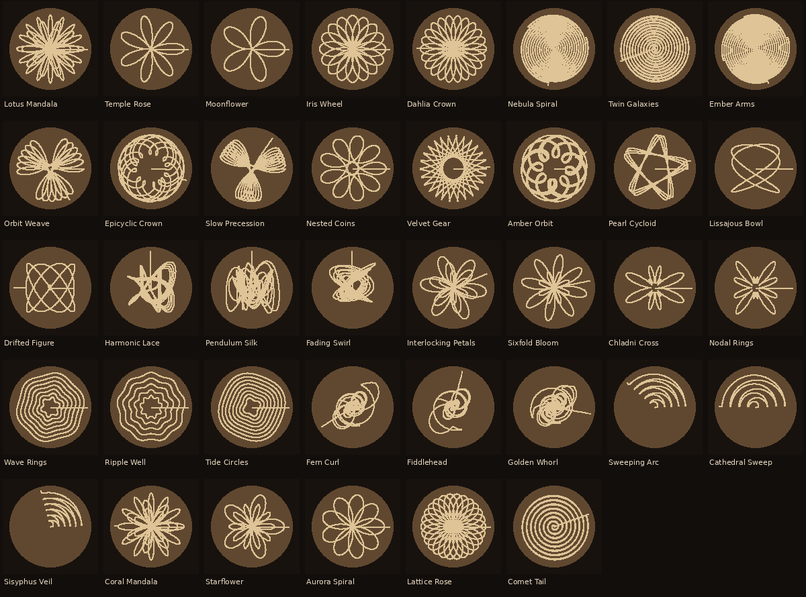

# HoMedics Drift


Home Assistant custom integration for the Bluetooth HoMedics Drift sand tables. It talks to the table through Home Assistant's Bluetooth integration, so a USB adapter or an ESPHome Bluetooth proxy both work. No table address is hardcoded.

**This project is unofficial and is not affiliated with, endorsed by, or supported by HoMedics.** It drives a motorized sand table over an undocumented Bluetooth protocol. Use it at your own risk. A bad or interrupted session can leave a drawing unfinished; it should not damage the table, but that is not a promise.

## Credit

All credit for the protocol goes to Josh Lannin's [Drifted](https://github.com/joshlannin/drifted) project. Drifted reverse-engineered how these Bluetooth sand tables speak, tested a generation-1 16" table, and published the handshake, packet format, failure modes, and the vectors in `spec/vectors/protocol.json`. Drifted is MIT licensed, copyright Altimix LLC.

This Home Assistant integration was converted from Drifted using Grok Bot.

afcragg78 posted this repository. They are not the author of Drifted or of this conversion. `manifest.json` lists `@afcragg78` under `codeowners` only because Home Assistant requires a GitHub handle there. That entry is the person who posted the repository, not an authorship credit.

## Supported models

| Model | Radio | Status |
| --- | --- | --- |
| Drift 16" (ST-300) | Bluetooth, advertised name `KS` plus at least 12 characters | Protocol tested by Drifted (controller `A_11_V0.7.12`, driver `B_11_V0.3.3`) |
| Drift 21" (ST-400) | Same Bluetooth app and protocol | Should work. Not tested on hardware by Drifted |
| Drift 11" (ST-200, ST-250) | Wi-Fi and a cloud service | Not this protocol. This integration will not control them |

Tables do not pair. Only one Bluetooth central can be connected. While Home Assistant holds the link, the HoMedics phone app cannot connect. Disabling this config entry, or stopping Home Assistant, closes the connection so the phone app can connect again. Drawing that is already running on the table keeps going.

The advertised name sometimes has a trailing carriage return or line feed. The integration trims that before matching. Discovery uses Home Assistant's Bluetooth matcher `local_name: KS*`.

Requires Home Assistant 2026.11 or newer.

## Icon

The artwork is original. It is a circular sand table, a spiral in the sand, and a small ball, in warm sand tones, on a transparent background. It is not a HoMedics logo and it does not use Home Assistant's logo.

Since Home Assistant 2026.3, a custom integration ships its own images in `custom_components/<domain>/brand/`. This repository includes:

| File | Size |
| --- | --- |
| `custom_components/homedics_drift/brand/icon.png` | 256×256 |
| `custom_components/homedics_drift/brand/icon@2x.png` | 512×512 |
| `custom_components/homedics_drift/brand/logo.png` | 543×256 |
| `custom_components/homedics_drift/brand/logo@2x.png` | 1085×512 |

After the integration is installed, Home Assistant shows that icon on the Integrations page automatically. Local images take priority over the brands CDN. Nothing has to be added to the [home-assistant/brands](https://github.com/home-assistant/brands) repository, so this repo does not include a `brands-submission/` folder. The Marketplace can also pick the images up from a GitHub release once the repository is in the catalog.

## Install

The repository has to be public, and it has to contain `hacs.json`, before the Marketplace or HACS will accept it.

### Home Assistant 2026.11 and newer (Marketplace)

HACS ships with Home Assistant as Settings → Marketplace. There is no separate HACS download.

1. Open **Settings → Marketplace**.
2. If GitHub is not connected yet, connect it when asked. The Marketplace uses GitHub device sign-in and only reads public repositories.
3. In the upper-right corner, select **Add from link**.
4. Under GitHub link, enter `https://github.com/afcragg78/ha-homedics-drift` (or `afcragg78/ha-homedics-drift`).
5. Select **Add**. If the type is not detected, choose **Integration** and select **Add** again.
6. Open **HoMedics Drift** in the list and install it.
7. If the integration does not appear yet, restart Home Assistant.
8. Plug in the sand table. Home Assistant should discover it. Confirm the prompt, or go to **Settings → Devices & services → Add integration → HoMedics Drift** and pick the table from the list.

You can also open this link on a phone that has the Home Assistant app, which adds the repository for both the Marketplace and classic HACS:

[Add HoMedics Drift](https://my.home-assistant.io/redirect/hacs_repository/?owner=afcragg78&repository=ha-homedics-drift&category=integration)

### Classic HACS (Home Assistant 2026.10 and older)

This integration uses current Home Assistant APIs (`probatio` config schemas, `entry.runtime_data`). Those are not in 2026.10. Classic HACS can still add the repository, but install it only on 2026.11 or newer.

1. In the HACS panel, open **Integrations**.
2. Open the menu (three dots) and choose **Custom repositories**.
3. Repository: `https://github.com/afcragg78/ha-homedics-drift`. Category: **Integration**. Select **Add**.
4. Find **HoMedics Drift** in the integration list and download it.
5. Restart Home Assistant.
6. Add the integration as in step 8 above.

## What you get

One device per table. Entity names are prefixed with the table's Bluetooth name.

| Entity | Role |
| --- | --- |
| `light` Light | Off is brightness 0 (`0x14/7`) and stays off. On restores the last colour the way Drifted does (`0x14/15` with the enable byte, `0x14/13` `Temp`, `0x11/4` at the last non-zero brightness or 100) and then sends that same non-zero brightness with `0x14/7`, which is what relights the LEDs. |
| `switch` Power | An integration switch, remembered across restarts. The table has no real power-off: `0x14/16` with 0 only pauses, and the `powerOn` flag stays on, so the switch does not follow that flag. Off pauses a moving ball and turns the lamp off, remembering the colour and brightness. On restores that lamp and resumes play. Play, pause, next, and previous never move this switch. |
| `media_player` Player | Available whenever the table is connected. While Power is off it stays off and offers no play, pause, next, previous, or source button. While Power is on it shows playing or paused, with those transport buttons and no power button of its own. |
| `number` Speed | 0–100%. The table's raw speed byte runs from 30 to 75 (`30 + percent/100 × 45`). 0% is raw 30 and 100% is raw 75, which is what the HoMedics app calls full speed. |
| `select` Playlist | Every playlist the table itself sends during the session dump (`0x30`, actions 1–4), refreshed on each connection. A human name in the packet is shown. Numeric ids, including the app's millisecond timestamps, stay behind the command and are labeled `Playlist N`. Choosing one sends draw-from-playlist (`0x14/2`) with that id and the first pattern id in the list, or pattern 0 when the table did not include pattern ids. Nothing is hardcoded. Ignored while soft power is off. |
| `select` Pattern | Every pattern id the table lists. A name saved by upload or rename is shown; otherwise `Pattern N`. Choosing one plays that id. Ignored while Power is off. |
| `select` Folder pattern | `.thr` files in `/config/drift_patterns` that have not been uploaded. Choosing one does not upload it. |
| `button` Upload folder pattern | Uploads the file chosen in Folder pattern. |
| `button` Refresh pattern folder | Looks again for new `.thr` files. Does not upload them. |
| `image` Now Playing preview | A sand picture of the current pattern, when that pattern was uploaded from here. |
| `sensor` Pattern slots | How many patterns the table has stored, and how many new ones are still allowed under the cap of 700. |
| `sensor` Now Playing | The current pattern name, or Idle when the table reports pattern 0. Attributes: playlist name, 1-based index in that playlist when the id is in it, progress percent, pattern id, and `stored_patterns`. |
| `sensor` Status | `drawing` or `idle` from the running-state status byte. Attributes include colour name, playlist id, random, loop, sleep, breathing, shifting, and the controller and driver versions. |
| `sensor` Progress | Pattern progress. The wire value 0–10000 is shown as 0–100%. It does not advance while the ball travels to a pattern's first point, and it can still read 100% for a moment after the next pattern starts. |
| `sensor` Pattern id | Numeric pattern id currently reported by the table. Idle is often id 0. |

State is pushed by the table about twice a second (`0x35/1`). The integration answers every table message with ConfirmData, answers the time request (`0x32/2`) with the local time, and answers the connection prompt (`0x50/1`) with confirm-connection. An acknowledgement from the table (the ack bit) gets ConfirmData and is never answered in kind, which is what avoids the time-packet loop. The session is ready after init complete (`0x4F/1`).

If the table is unplugged or walks out of range, the entities become unavailable. The integration reconnects with backoff (2 seconds, doubling, capped at 60 seconds) and becomes available again after the next handshake. Notifications and writes are asynchronous and do not block Home Assistant's event loop.

## Drawing a new pattern

The table does not store names or pictures. Home Assistant keeps those.

1. Open [Sandify](https://sandify.org) and draw a pattern.
2. Export it as a `.thr` file (theta in radians, rho from 0 at the centre to 1 at the rim).
3. Copy the file to `/config/drift_patterns/` on the Home Assistant machine. The folder is created for you.
4. Press **Refresh pattern folder**, choose the file under **Folder pattern**, then press **Upload folder pattern**. Dropping the file in the folder does not upload it.
5. Or call the service `homedics_drift.upload_pattern` with a name and either `path` (`/config/drift_patterns/spiral.thr`) or the raw `thr` text.

The upload uses a new id at or above 50000. It will not replace a pattern that shipped with the table, and it will not replace the pattern that is drawing. Pages of 40 points go out about 100 ms apart. The pattern is kept only when the table says it was stored (`0x34/3`). If the link drops in the middle, the table throws away the partial file after a few seconds and stays usable.

New uploads stop when the table already lists 700 patterns, which is under its limit of about 800. **Pattern slots** shows how many are used and how many are free.

`homedics_drift.delete_pattern` deletes only an id this integration uploaded (50000 or above), and not the one that is drawing.

`homedics_drift.rename_pattern` changes the name shown in **Pattern** for any id, including a stock one. That name stays on this Home Assistant machine. The table is not told.

**Now Playing preview** shows a sand picture of the current pattern when that pattern was uploaded here.

**Clean sand** plays a wipe. If the table sends a playlist named `clean` (that is the first entry in the HoMedics app's downloaded list), its pattern is used. Otherwise a tight spiral from the centre to the rim is uploaded once, preferring id 50000, and marked so delete will not remove it. The button is unavailable while Power is off, and it does not turn Power on. A full wipe takes on the order of ten minutes. The button only starts it.

**Clean before pattern**, when switched on, does that wipe before a pattern you pick in **Pattern**, then starts the pattern you picked after the wipe finishes. Play and pause do not wipe. Turning Power off cancels a wipe that was waiting to start the next pattern.

An upload holds the Bluetooth connection until it finishes, so power, play, and a second upload wait their turn instead of cutting the page stream. Power, light, pause, and play themselves are unchanged.

## Drawing without the phone app

Two ways to make a new pattern. Both save a name, the `.thr` text, and a sand preview, then upload with the same rules as a file: ids from 50000, never a stock id, never the pattern that is drawing, never the protected clean pattern, and never past 700 stored patterns.

**Built-in shapes** need no assistant:

```yaml
action: homedics_drift.generate_pattern
data:
  type: rose
  petals: 5
  name: Rose
  play: true
```

`type` is `spiral`, `rose`, `star`, `wave`, or `spirograph`. Spiral takes `turns` (1–40). Star takes `points` (3–12). Wave takes `waves`. Spirograph takes `outer`, `inner`, `pen`, and `loops`. `play: true` starts it only while Power is on. If Power is off the pattern is still saved, and it is not played.

**A prompt** uses the assistant you already set up in Home Assistant. This integration does not store an API key. Open the integration options and pick an AI Task entity. If you leave that empty, the default AI Task is used when one is installed. If there is no AI Task, a conversation agent is used instead, and you can pick which agent in the same options. Each drawing is a single request. If you have neither, **Draw with AI** stays unavailable.

Type the prompt in the **AI prompt** text box, then press **Draw with AI**. Or call the service:

```yaml
action: homedics_drift.ai_draw
data:
  prompt: a five pointed star
  name: Star
  play: true
```

The assistant is asked for one list of `[x, y]` points inside a circle. Those points are resampled, kept inside the disc, started at the centre, finished on the rim, and turned into a `.thr` path. If the answer is not a path, nothing is uploaded and **AI drawing** shows the error. The same sensor shows `running` while the request is in flight and `stored` when the table has accepted the pattern.

## Gallery

Thirty-eight intricate designs are built into the integration. They are generated in code, not downloaded. Each path is one continuous line from the centre to the rim: layered mandalas, spirograph weaves, fractional roses, Lissajous figures, decaying harmonographs, galaxies, Chladni-style bands, wave rings, fern curls, and long sweeping arcs.

Pick one in **Gallery design**. The row picture and **Gallery preview** show that design. Nothing is sent until you press **Send gallery design** or call:

```yaml
action: homedics_drift.add_gallery_design
data:
  name: Lotus Mandala
  play: true
```

`play: true` starts it only while Power is on. **Random design** uploads a new variation of one of those designs. The same seed always repeats; each press uses a new seed.



## What this integration does not do

- The table does not send a stored pattern's path back, so a preview exists only for a pattern uploaded from this Home Assistant machine. Stock patterns can be renamed for the select, but they have no picture until you upload a file of your own.
- It never sends firmware update commands (`0x15`) or the reserved reset (`0x14/12`).
- It does not write playlist definitions (`0x10`). Those commands replace playlists stored on the table. The select only reads the `0x30` list the table sends after connect.
- The `0x30` payload is documented as strings and 16-bit arrays, in the same page framing as colour pages and stored-pattern pages, but the exact layout is not spelled out byte for byte. The parser accepts a named page, an indexed page, a bare index list, or a name list, and it uses the first layout that consumes the packet. A playlist packet in some other layout is logged at debug and is not shown. If your table's list stays empty, that is the gap to report.
- Sleep schedules, the colour-palette editor, random, and loop are not separate controls. Random and loop are visible on the status sensor. Setting a colour turns shifting and breathing off so the colour sticks.
- Favourites (`0x36`) are not added to the playlist select.
- The 21" ST-400 uses the same app and should speak this protocol. It has not been confirmed on hardware.

## Development

```bash
python -m pip install pytest pillow
python -m pytest
```

Tests live in `tests/` and do not need Home Assistant or a table. `tests/fixtures/protocol.json` is Drifted's `spec/vectors/protocol.json`. GitHub Actions runs those tests plus hassfest and HACS validation.

## License

MIT, matching Drifted's license. See [LICENSE](LICENSE). The copyright notice is Altimix LLC, the copyright holder of Drifted. This integration was converted from that project using Grok Bot. The person who posted this repository is not the author.
