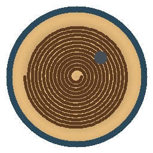

# HoMedics Drift



Home Assistant custom integration for the Bluetooth HoMedics Drift sand tables. It talks to the table through Home Assistant's Bluetooth integration, so a USB adapter or an ESPHome Bluetooth proxy both work. No table address is hardcoded.

**This project is unofficial and is not affiliated with, endorsed by, or supported by HoMedics.** It drives a motorized sand table over an undocumented Bluetooth protocol. Use it at your own risk. A bad or interrupted session can leave a drawing unfinished; it should not damage the table, but that is not a promise.

## Credit

All credit for the protocol goes to Josh Lannin's [Drifted](https://github.com/joshlannin/drifted) project. Drifted reverse-engineered how these Bluetooth sand tables speak, tested a generation-1 16" table, and published the handshake, packet format, failure modes, and the vectors in `spec/vectors/protocol.json`. Drifted is MIT licensed, copyright Altimix LLC.

This Home Assistant integration was converted from Drifted using Grok Bot.

afcragg78 posted this repository. They are not the author of Drifted or of this conversion. `manifest.json` lists `@afcragg78` under `codeowners` only because Home Assistant requires a GitHub handle there. That entry is the person who posted the repository, not an authorship credit.

## Supported models

| Model | Radio | Status |
| --- | --- | --- |
| Drift 16" (ST-300) | Bluetooth, advertised name `KS` plus at least 12 characters | Protocol tested by Drifted (controller `A_11_V0.7.12`, driver `B_11_V0.3.3`) |
| Drift 21" (ST-400) | Same Bluetooth app and protocol | Should work. Not tested on hardware by Drifted |
| Drift 11" (ST-200, ST-250) | Wi-Fi and a cloud service | Not this protocol. This integration will not control them |

Tables do not pair. Only one Bluetooth central can be connected. While Home Assistant holds the link, the HoMedics phone app cannot connect. Disabling this config entry, or stopping Home Assistant, closes the connection so the phone app can connect again. Drawing that is already running on the table keeps going.

The advertised name sometimes has a trailing carriage return or line feed. The integration trims that before matching. Discovery uses Home Assistant's Bluetooth matcher `local_name: KS*`.

Requires Home Assistant 2026.11 or newer.

## Icon

The artwork is original. It is a circular sand table, a spiral in the sand, and a small ball, in warm sand tones, on a transparent background. It is not a HoMedics logo and it does not use Home Assistant's logo.

Since Home Assistant 2026.3, a custom integration ships its own images in `custom_components/<domain>/brand/`. This repository includes:

| File | Size |
| --- | --- |
| `custom_components/homedics_drift/brand/icon.png` | 256×256 |
| `custom_components/homedics_drift/brand/icon@2x.png` | 512×512 |
| `custom_components/homedics_drift/brand/logo.png` | 543×256 |
| `custom_components/homedics_drift/brand/logo@2x.png` | 1085×512 |

After the integration is installed, Home Assistant shows that icon on the Integrations page automatically. Local images take priority over the brands CDN. Nothing has to be added to the [home-assistant/brands](https://github.com/home-assistant/brands) repository, so this repo does not include a `brands-submission/` folder. The Marketplace can also pick the images up from a GitHub release once the repository is in the catalog.

## Install

The repository has to be public, and it has to contain `hacs.json`, before the Marketplace or HACS will accept it.

### Home Assistant 2026.11 and newer (Marketplace)

HACS ships with Home Assistant as Settings → Marketplace. There is no separate HACS download.

1. Open **Settings → Marketplace**.
2. If GitHub is not connected yet, connect it when asked. The Marketplace uses GitHub device sign-in and only reads public repositories.
3. In the upper-right corner, select **Add from link**.
4. Under GitHub link, enter `https://github.com/afcragg78/ha-homedics-drift` (or `afcragg78/ha-homedics-drift`).
5. Select **Add**. If the type is not detected, choose **Integration** and select **Add** again.
6. Open **HoMedics Drift** in the list and install it.
7. If the integration does not appear yet, restart Home Assistant.
8. Plug in the sand table. Home Assistant should discover it. Confirm the prompt, or go to **Settings → Devices & services → Add integration → HoMedics Drift** and pick the table from the list.

You can also open this link on a phone that has the Home Assistant app, which adds the repository for both the Marketplace and classic HACS:

[Add HoMedics Drift](https://my.home-assistant.io/redirect/hacs_repository/?owner=afcragg78&repository=ha-homedics-drift&category=integration)

### Classic HACS (Home Assistant 2026.10 and older)

This integration uses current Home Assistant APIs (`probatio` config schemas, `entry.runtime_data`). Those are not in 2026.10. Classic HACS can still add the repository, but install it only on 2026.11 or newer.

1. In the HACS panel, open **Integrations**.
2. Open the menu (three dots) and choose **Custom repositories**.
3. Repository: `https://github.com/afcragg78/ha-homedics-drift`. Category: **Integration**. Select **Add**.
4. Find **HoMedics Drift** in the integration list and download it.
5. Restart Home Assistant.
6. Add the integration as in step 8 above.

## What you get

One device per table. Entity names are prefixed with the table's Bluetooth name.

| Entity | Role |
| --- | --- |
| `light` Light | The sand-table lamp. Off sends brightness 0 (`0x14/7`) and the toggle is set off immediately. A later status packet that still says the lamp is on does not turn the toggle back on; brightness 0, or a light-mode echo (`0x31/4`) with brightness 0, confirms off. On restores the last colour (`0x14/15` with the enable byte, then `0x14/13`) and light mode `0x11/4` with the last non-zero brightness, or 100 when the table has not reported one. A chosen RGB colour uses that same three-packet recipe. Brightness is the table's 0–100 scale, shown in Home Assistant as 0–255. |
| `switch` Power | Soft power, command `0x14/16`. This is the table's own power flag. It is not a mains plug and it does not control a smart outlet. |
| `media_player` Player | Play, pause, next pattern (`0x14/4`), and previous pattern (`0x14/5`). Play and pause are a single toggle on the wire (`0x14/3`); the player only sends it when the reported state needs to change. Turn on powers the table if it is off, then starts playback when the ball is idle. The title is the current pattern id. |
| `number` Speed | 0–100%. The table's raw speed byte runs from 30 to 75 (`30 + percent/100 × 45`). 0% is raw 30 and 100% is raw 75, which is what the HoMedics app calls full speed. |
| `select` Playlist | Every playlist the table itself sends during the session dump (`0x30`, actions 1–4), refreshed on each connection. A human name in the packet is shown. Numeric ids, including the app's millisecond timestamps, stay behind the command and are labeled `Playlist N`. Choosing one sends draw-from-playlist (`0x14/2`) with that id and the first pattern id in the list, or pattern 0 when the table did not include pattern ids. Nothing is hardcoded. |
| `sensor` Status | `drawing` or `idle` from the running-state status byte. Attributes include colour name, playlist id, random, loop, sleep, breathing, shifting, and the controller and driver versions. |
| `sensor` Progress | Pattern progress. The wire value 0–10000 is shown as 0–100%. It does not advance while the ball travels to a pattern's first point, and it can still read 100% for a moment after the next pattern starts. |
| `sensor` Pattern | Pattern id currently reported by the table. Idle is often id 0. |

State is pushed by the table about twice a second (`0x35/1`). The integration answers every table message with ConfirmData, answers the time request (`0x32/2`) with the local time, and answers the connection prompt (`0x50/1`) with confirm-connection. An acknowledgement from the table (the ack bit) gets ConfirmData and is never answered in kind, which is what avoids the time-packet loop. The session is ready after init complete (`0x4F/1`).

If the table is unplugged or walks out of range, the entities become unavailable. The integration reconnects with backoff (2 seconds, doubling, capped at 60 seconds) and becomes available again after the next handshake. Notifications and writes are asynchronous and do not block Home Assistant's event loop.

## What this integration does not do

- It does not upload sand patterns. The codec can build upload packets, and the tests check them against Drifted's vectors, but there is no upload service. Uploads are easy to get wrong: only `0x34/3` means the pattern was stored, pages must be 100 ms apart, and an empty missing-page list means the last pages were lost.
- It never sends firmware update commands (`0x15`) or the reserved reset (`0x14/12`).
- It does not write playlist definitions (`0x10`). Those commands replace playlists stored on the table. The select only reads the `0x30` list the table sends after connect.
- The `0x30` payload is documented as strings and 16-bit arrays, in the same page framing as colour pages and stored-pattern pages, but the exact layout is not spelled out byte for byte. The parser accepts a named page, an indexed page, a bare index list, or a name list, and it uses the first layout that consumes the packet. A playlist packet in some other layout is logged at debug and is not shown. If your table's list stays empty, that is the gap to report.
- Sleep schedules, the colour-palette editor, random, and loop are not separate controls. Random and loop are visible on the status sensor. Setting a colour turns shifting and breathing off so the colour sticks.
- Favourites (`0x36`) are not added to the playlist select.
- The 21" ST-400 uses the same app and should speak this protocol. It has not been confirmed on hardware.

## Development

```bash
python -m pip install pytest
python -m pytest
```

Tests live in `tests/` and do not need Home Assistant or a table. `tests/fixtures/protocol.json` is Drifted's `spec/vectors/protocol.json`. GitHub Actions runs those tests plus hassfest and HACS validation.

## License

MIT, matching Drifted's license. See [LICENSE](LICENSE). The copyright notice is Altimix LLC, the copyright holder of Drifted. This integration was converted from that project using Grok Bot. The person who posted this repository is not the author.
